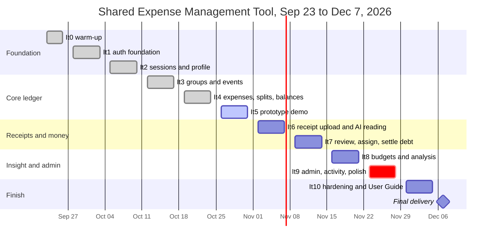

# Project Plan: Shared Expense Management Tool

*CS451R Agile Software Engineering Capstone*

| Document field | Team entry |
|---|---|
| Project title | Shared Expense Management Tool |
| Team name | LCMX Inc. |
| Team members | Colton "Cole" Hanson (frontend, LLM), Mick Leinbach (database), Lukas Viskovic (backend), Xander McKie (testing, documentation, Figma designs) |
| Student document owner | Xander McKie |
| Instructor | Prof. Jawad |
| Sponsor or client | Commerce Bank |
| Version and date | 1.0 Draft, October 29, 2026 |
| Approval status | Draft |

> Repository: <https://github.com/Colton-Hanson/LCMX-Inc.> · Live backlog: JIRA (SCRUM project) · Companion documents: Project Charter, Requirements Specification, System Architecture.

## Revision history

| Version | Date | Author | Summary of change | Reviewer or approval |
|---|---|---|---|---|
| 0.1 | Oct 15, 2026 | Xander McKie | First project plan (`planningdoc.md`) baselined from the Charter, Requirements, and Iteration Plan | Team |
| 1.0 | Oct 29, 2026 | Xander McKie | Reformatted to the course plan template; status updated to the repository as of Oct 29; open-issue answers and Sprint 4 results added | Pending team review |

## Contents

1. [Plan overview](#1-plan-overview)
2. [Release strategy](#2-release-strategy)
3. [Backlog and work breakdown](#3-backlog-and-work-breakdown)
4. [Estimation and capacity](#4-estimation-and-capacity)
5. [Schedule and dependencies](#5-schedule-and-dependencies)
6. [Sprint operating plan](#6-sprint-operating-plan)
7. [Roles and responsibilities](#7-roles-and-responsibilities)
8. [Communication plan](#8-communication-plan)
9. [Quality plan](#9-quality-plan)
10. [Risks and issues](#10-risks-and-issues)
11. [Change and configuration control](#11-change-and-configuration-control)
12. [Progress tracking](#12-progress-tracking)
13. [Tools and environments](#13-tools-and-environments)
14. [Review and submission](#14-review-and-submission)

---

# 1 Plan overview

## 1.1 Product goal and minimum viable product

**Product goal:** *Collaborative finance for people who actually share their lives.* Roommates, partners, families, and groups on an outing can record shared costs, split them fairly, see who owes whom, and (with an AI reading their receipts) avoid typing in every line item.

**Minimum viable product (MVP):** a user can register and log in, create a group (and events inside it), add an expense with an even, custom, or percentage split, see balances, upload a receipt and have the AI read it, review and correct what was read, and record a settlement. It works on a phone and a PC.

**Stretch (only if every MUST is done and tested):** web API for the backend, self-hosted auth with password reset, formal ADA audit, group-level shared budget goals.

**Out of scope:** bank access, real money movement, enforcement of budget rules, native mobile app, admin access to individual user data.

## 1.2 Planning approach and horizon

Work runs in one-week iterations (sprints), Monday to Friday, from Iteration 0 (Sep 23) through Iteration 10 (ending Dec 4), with final delivery on **Dec 7, 2026**. The sprint backlog lives in JIRA; this plan is the project-level view. Iterations 0 to 5 follow the Iteration Plan; Iterations 6 to 10 are candidate backlogs, refined at each Friday close-out. When the schedule slips, COULD requirements are cut first, then SHOULD; MUST requirements are not cut.

**Where we are (Oct 29):** Iterations 0 to 4 are merged to `main`. Iteration 5 (Oct 26 to 30) is the prototype demo: bug fixes, demo data, and no new features.

An analogy: this is a road trip with a fixed arrival time. The route (iterations) is fixed, and the stops (features) are what we trim if we fall behind.

## 1.3 Priorities, constraints, and assumptions

| Type | Statement | Planning effect |
|---|---|---|
| Priority | Core ledger first: users, groups, expenses, splits, balances (OBJ-1) | Built in Iterations 1 to 4 |
| Priority | Human review of every AI-extracted value (OBJ-3) | The review screen ships with the receipt feature (Iteration 7) |
| Priority | Tests written continuously, not at the end (OBJ-10) | Every ticket includes a test in its Definition of Done |
| Constraint | Final delivery Dec 7, 2026; the Charter states the date does not move | Scope is cut before dates move |
| Constraint | PostgreSQL, hashed passwords, exactly one CSS framework, phone and PC support | Fixed technical choices |
| Constraint | Thanksgiving week (Iteration 9, Nov 23 to 27) has reduced capacity | See R-9 |
| Assumption | An LLM with image reading is available (vendor decision OI-03, due Nov 2) | Receipt work starts Iteration 6 |
| Assumption | Demo is served over HTTPS; all test data is synthetic | No real financial data ever |
| Assumption | All four members are available each week | Checked in Section 4.3 |

---

# 2 Release strategy

## 2.1 Deliverables and milestones

Dates are the Iteration Plan dates. The Charter dates for M3 to M8 are earlier by one to two weeks (see R-8).

| ID | Milestone | Charter target | Planned | Exit criteria | Status |
|---|---|---|---|---|---|
| M1 | Use cases written and reviewed | Sep 18 | Sep 18 | 16 use cases | Done |
| M2 | Foundations | Sep 25 | Sep 25 | Charter, requirements, architecture drafted; repo and environments set up | Done |
| M3 | Accounts and database | Oct 2 | Oct 9 (end It2) | PostgreSQL schema; register, login, hashing, persistent sessions, guest redirect, profile and settings; test harness | Done |
| M4 | Core ledger | Oct 16 | Oct 23 (end It4) | Groups, events, members, manual expenses, all split methods, autosplit, running balances | Done (merged Oct 27) |
| Prototype | Prototype demo | none | Oct 30 (end It5) | Demo of the built app plus Figma/mockup screens; no new features | In progress |
| M5 | Receipts | Oct 30 | Nov 13 (end It7) | Upload from file, gallery and camera; LLM extraction to JSON; review-and-assign screen; failed upload and failed read handled; receipt deletion | Planned |
| M6 | Money, insight, admin | Nov 13 | Nov 27 (end It9) | Budgets and goals, analysis, settle debt, activity, notifications, admin dashboard with the privacy boundary; feature freeze | Planned |
| M7 | Hardening | Nov 27 | Dec 4 (end It10) | Full test pass with report; security and ADA checklists; load check; User Guide complete | Planned |
| M8 | Final delivery | Dec 2 | Dec 7 | Final presentation, live demo of all core features, source files | Planned |

**Required documents:** 1 Project Charter, 2 Requirements Specification, 3 Project Plan (this file), 4 System Architecture, 5 Test Documentation, 6 Team Effort Estimation, 7 User Guide; plus F1 final presentation and F2 source files.

## 2.2 Sprint roadmap

| Iteration | Dates | Goal | Demonstrable outcome | Dependencies | Review evidence |
|---|---|---|---|---|---|
| It0 | Sep 23 to 25 | Warm-up | Repo runs from the README; backlog in JIRA; ERD and first migrations; LLM/OCR recommendation | None | README, JIRA |
| It1 | Sep 28 to Oct 2 | Auth foundation | Register and login with hashing and generic errors | ERD, migrations | Auth tests |
| It2 | Oct 5 to 9 | Sessions, profile, guest handling | Persistent sessions, profile, route guards | It1 | Auth and profile tests |
| It3 | Oct 12 to 16 | Groups, events, membership | Create group, invite, accept/decline, add/remove member with balance check, create event; Figma style guide and wireframes | Auth | Group and event tests (FR-GRP-01 to 16) |
| It4 | Oct 19 to 23 | Manual expenses, splits, balances | Add expense with three split methods, balances page; high-fidelity Figma prototype | Groups | Expense and balance tests; 108 backend tests passing at handoff |
| It5 | Oct 26 to 30 | Prototype demo | Seeded demo data; bug fixes; recorded demo and mockups; rehearsal | It4 build | Demo video, mockup screens |
| It6 | Nov 2 to 6 | Receipt upload and LLM extraction | Upload photo or PDF, AI reads it, items saved; distinct upload vs reading errors; edit and delete expense routes (FR-EXP-10 to 17, 32) | OI-03, OI-17, OI-21; It5 bug fixes | 15-receipt test set, mocked-LLM tests |
| It7 | Nov 9 to 13 | Review and assign; settle debt | Edit items, assign to people, save; settle debt full and partial; receipt picture deletion (FR-EXP-20 to 26, FR-SPL-13 to 17, FR-EXP-30 to 33) | It6 tables, balances | Review and settlement tests; M5 |
| It8 | Nov 16 to 20 | Budgets, goals, analysis | Budget screens, goals, monthly analysis with chart and empty state; recurring expenses (FR-BUD, FR-ANL-01 to 05, FR-EXP-06) | Expenses data, OI-09 to 12 | Budget and analysis tests |
| It9 | Nov 23 to 27 | Admin, activity, polish (Thanksgiving, reduced capacity) | Admin dashboard with privacy boundary; activity history; UI polish; feature freeze (FR-ADM-01 to 07, FR-SOC-01) | OI-13; balances | Blocked-admin-path tests; M6 |
| It10 | Nov 30 to Dec 4 | Hardening | Full test pass and report; security and ADA audits; load check; User Guide; HTTPS deployment | Feature freeze | Test report; M7 |
| Delivery | Dec 7 | Final delivery | Presentation, live demo, source files | It10 | Submission; M8 |

---

# 3 Backlog and work breakdown

## 3.1 Prioritized product backlog

Priority: **M** = MUST, **S** = SHOULD, **C** = COULD (as in the Requirements Specification). Tickets are in JIRA with the requirement ID as a label.

| Rank | Item | Requirements | Priority | Iteration | Status |
|---|---|---|---|---|---|
| 1 | Account creation, login, sessions, profile | FR-ACC-01 to 17 | M | It1, It2 | Done |
| 2 | Groups, invitations, members | FR-GRP-01 to 12 | M | It3 | Done |
| 3 | Events (member subsets) | FR-GRP-13 to 16 | M | It3 | Done (event-expense link pending) |
| 4 | Manual expense, even/custom/percentage splits, autosplit | FR-EXP-01 to 05, FR-SPL-03, 04, 06, 07, 08, 10 | M | It4 | Done |
| 5 | Balances | FR-SPL-11, 12 | M | It4 | Done |
| 6 | Prototype demo | n/a | n/a | It5 | In progress |
| 7 | Receipt upload and AI reading | FR-EXP-10 to 17 | M | It6 | Planned |
| 8 | Edit and delete expense | FR-EXP-32, NFR-DAT-02 | M | It6 | Planned (not yet placed in the Iteration Plan) |
| 9 | Review and assign extracted items | FR-EXP-20 to 26 | M | It7 | Planned |
| 10 | Settle debt (full or partial) | FR-SPL-13 to 17 | M | It7 | Planned |
| 11 | Delete receipt picture, keep items | FR-EXP-30, 31, 33 | S | It7 | Planned |
| 12 | Budgets, goals, analysis | FR-BUD-01 to 06, FR-ANL-01 to 05 | M/S | It8 | Planned |
| 13 | Recurring expenses | FR-EXP-06 | S | It8 | Planned |
| 14 | Admin dashboard (aggregate only), activity | FR-ADM-01 to 07, FR-SOC-01 | M/S | It9 | Planned |
| 15 | Notifications | FR-SOC-02 | S | It9 if capacity allows | Candidate |
| 16 | Comments, reactions, advice | FR-SOC-03, FR-ANL-06 | C | It9 only if every MUST is done, else cut | Candidate |
| 17 | Standalone split creation (UC-03) and saved group ratio | FR-SPL-01, 02, 05, 09 | M/S/C | Confirm whether It4 splits satisfy UC-03 | Open |
| 18 | Password reset | FR-ACC-11 | S | Depends on OI-02; otherwise stretch goal | Open |
| 19 | Security audit, ADA checklist, load check, rate limiting | NFR-SEC-05, 08, NFR-A11Y-04, NFR-PER-01 | M/S | It10 | Planned |
| 20 | User Guide, Test Documentation, final documents | NFR-QUA-02 | M | It3 to It10 | Ongoing |

## 3.2 Work breakdown structure

```
1 Shared Expense Management Tool
├── 1.1 Project management
│   ├── 1.1.1 Charter, plan, estimation
│   ├── 1.1.2 Iteration planning, close-outs, retrospectives
│   └── 1.1.3 Risk and change tracking
├── 1.2 Accounts and access
├── 1.3 Groups and events
├── 1.4 Expenses and splits
│   ├── 1.4.1 Manual expense
│   ├── 1.4.2 Split engine (even, custom, percentage, autosplit)
│   └── 1.4.3 Balances and settlement
├── 1.5 Receipt capture
│   ├── 1.5.1 Upload and storage
│   ├── 1.5.2 LLM pipeline (JSON, retry)
│   └── 1.5.3 Review, assignment, picture deletion
├── 1.6 Budgets and analysis
├── 1.7 Administration and activity
├── 1.8 Frontend and design (React screens, Figma, mockups)
├── 1.9 Testing and quality
│   ├── 1.9.1 Unit and API tests (pytest, Vitest)
│   ├── 1.9.2 Receipt test set
│   └── 1.9.3 Security, accessibility, load checks
└── 1.10 Documentation and delivery
    ├── 1.10.1 Seven required documents
    └── 1.10.2 Final presentation and source files
```

## 3.3 Work packages

Hours come from the Iteration Plan where it estimated them (It3 to It5); the rest are planning estimates to be confirmed at each iteration kickoff.

| WP | Work package | Owner | Effort (h) | Iteration | Predecessor |
|---|---|---|---|---|---|
| 1.2 | Accounts, sessions, profile | Lukas, Cole, Mick | n/a (It1 to It2) | It1, It2 | ERD and migrations |
| 1.3 | Groups and events | Lukas 25, Cole 21, Mick 7, Xander 16 | 69 | It3 | 1.2 |
| 1.4.1 to 1.4.3 | Expenses, splits, balances | Lukas 27, Cole 24, Mick 13, Xander 23 | 87 | It4 | 1.3 |
| 1.8 | Prototype demo | Mick 5, Lukas 9, Cole 11, Xander 9 | 34 | It5 | 1.4 |
| 1.5.1 to 1.5.2 | Receipt tables, upload, extraction, upload screen | Mick, Lukas, Cole, Xander | TBD at It6 kickoff | It6 | OI-03 |
| 1.5.3, 1.4.3 | Review and assign, settle debt, picture deletion | Mick, Lukas, Cole, Xander | TBD at It7 kickoff | It7 | 1.5.1, 1.5.2 |
| 1.6 | Budgets, goals, analysis | Mick, Lukas, Cole, Xander | TBD | It8 | 1.4 |
| 1.7 | Admin, activity, polish | Mick, Lukas, Cole, Xander | TBD | It9 | 1.4.3, OI-13 |
| 1.9, 1.10 | Hardening, documents, final presentation | All | TBD | It10 | Feature freeze |

---

# 4 Estimation and capacity

## 4.1 Estimation method

Relative sizing (S, M, L, XL) when ranking the backlog, then ideal hours per task when a sprint is planned. Sprint tasks are small enough to finish in 1 to 3 days. We compare each sprint's planned hours with what the team actually finished (velocity in hours) and use the last two sprints to size the next one. A task not estimated cannot enter a sprint (Definition of Ready). The Team Effort Estimation document (required document 6) reports the actuals.

## 4.2 Effort versus duration

| Iteration | Planned effort | Duration | Why they differ |
|---|---|---|---|
| It3 groups and events | 69 h | 5 days | Four people in parallel; the backend waits on migrations |
| It4 expenses, splits, balances | 87 h | 5 days | Heaviest week; Xander also builds the Figma prototype |
| It5 prototype demo | 34 h | 5 days | Bug fixing and rehearsal only |
| It6 to It10 | Not yet estimated | 5 days each | Candidate backlogs, estimated at each kickoff |

Planned hours per member (from the Iteration Plan):

| Member | It3 | It4 | It5 |
|---|---|---|---|
| Mick | 7 | 13 | 5 |
| Lukas | 25 | 27 | 9 |
| Cole | 21 | 24 | 11 |
| Xander | 16 | 23 | 9 |
| **Total** | **69** | **87** | **34** |

*Actual hours are recorded in the Team Effort Estimation document (required document 6).*

## 4.3 Team capacity

Fill in each person's real hours at planning. The figures below are placeholders for a part-time student week; actual planned hours above are the better guide.

| Member | Hours/week available | Planned absence | Focus factor | Usable hours/week | Backup |
|---|---|---|---|---|---|
| Cole | TBD | TBD | 0.7 | TBD | Xander (UI fixes) |
| Mick | TBD | TBD | 0.7 | TBD | Lukas |
| Lukas | TBD | TBD | 0.7 | TBD | Mick |
| Xander | TBD | TBD | 0.7 | TBD | Cole (documents review) |

Usable hours = available hours × focus factor, minus absence. Thanksgiving week (It9) and exam weeks are counted at reduced hours.

---|---

# 5 Schedule and dependencies

## 5.1 Dependencies

| Dependency | Needed by | Why | Owner |
|---|---|---|---|
| ERD and migrations (It0) | Every task | All records live in the schema | Mick |
| Auth and sessions (It1, It2) | Groups and every later feature | Every record belongs to a signed-in user | Lukas |
| Groups and membership (It3) | Expenses (It4) | An expense belongs to a group | Lukas, Mick |
| Split calculator and balances (It4) | Receipt save and settle debt (It7), analysis (It8) | Everything downstream reads or writes balances | Lukas |
| Figma high-fidelity prototype (It4) | Screen builds in It7 to It9 | Cole builds from the Figma designs | Xander |
| LLM/OCR selection (OI-03), due Nov 2 | Extraction service (It6) | Cannot build without a tool and API key | Cole |
| Extracted JSON schema | Persistence and review screen (It6, It7) | Storage and review must agree on the shape | Cole, Lukas, Mick |
| It5 bug fixes | It6 start | Avoid regressions in new work | Lukas |
| Seed script with real password hashes | Demos | Seeded logins must work | Mick |
| Definition of site-level data (OI-13) | Admin dashboard (It9) | Charter risk R-3 | Team |
| Feature freeze (end It9) | Hardening (It10) | No new code once audits begin | Team |
| Demo hosting decision | It10 | HTTPS deployment and load check | Team |

**Handoff rules:** a migration merges before the endpoint that uses it. Backend and frontend agree on request and response shapes at kickoff, and the frontend builds against mocked responses until the endpoint lands. Features merge before the Friday close-out so the regression run covers them.

**Open-issue decision schedule:** an open issue is decided before the first story that depends on it enters an iteration, and the decision is written into the Requirements Specification the same week.

| Decision due | Open issues | Blocks |
|---|---|---|
| Done | OI-26 (test framework), OI-01, OI-02, OI-23, OI-24, OI-06 | Auth and groups |
| Oct 19 (It4) | OI-05, OI-07, OI-19, OI-20 | FR-GRP-11, 14, FR-SPL-09, FR-EXP-02. Final decisions need to be recorded. |
| Nov 2 (It6 start) | OI-03, OI-17, OI-21 | FR-EXP-13, 30, 01. OI-17 and OI-21 answered Oct 26; OI-03 with Cole. |
| Nov 9 (It7 start) | OI-16, OI-18 | FR-EXP-22, FR-SPL-13. OI-16 answered Oct 26. |
| Nov 16 (It8 start) | OI-09 to 12, OI-25, plus OI-13 to 15, OI-22 for the It9 admin build | FR-BUD, FR-ANL, FR-ADM, FR-ACC-14 |

## 5.2 Schedule



## 5.3 Critical work and float

The critical path is: **ERD and migrations → auth → groups → expenses, splits, balances → receipt upload and reading → review and assign → feature freeze (end of It9) → hardening → delivery.** The receipt pipeline carries the most technical uncertainty. Iteration 9 is the tightest week: the admin dashboard, activity history, and a UI polish pass land in Thanksgiving week right before the freeze. Items with float: notifications, comments and reactions, advice, recurring expenses, and the stretch goals. They are cut first.

## 5.4 Resource balancing

Xander carries testing, documentation, and Figma together, which is the main load risk (R-10). Iterations 3 and 4 are the heaviest (69 and 87 planned hours). If Xander is overloaded, Cole builds from the Figma wireframes and style page, and Mick takes small API endpoints. Lukas is the backup for database changes, and Mick for backend routes. Mandatory cross-review keeps a second person familiar with each component.

---

# 6 Sprint operating plan

## 6.1 Cadence

| Event | When | Length | Purpose |
|---|---|---|---|
| Iteration kickoff | Monday | 30 min | Pick tickets, confirm estimates and owners, agree request and response shapes |
| Stand-up | Start of each class | 10 min | What moved, what is blocked, who is unblocking it |
| JIRA updates | As work moves | n/a | Never batched at the end of the week |
| Friday close-out | Friday | 45 min | Demo what is done; run the full regression suite; move unfinished stories back to the backlog instead of silently rolling them over; write the next iteration's candidate backlog |
| Retrospective | Friday, after close-out | 20 min | One thing to keep, one to change |

## 6.2 Sprint plan fields

Each sprint plan (kept as a short document or JIRA sprint page) states: sprint number and dates; sprint goal in one sentence; tickets with owner and estimate; what is explicitly out of scope; decisions made (for example, Open Issue answers); risks and dependencies; and the plan for the review. The Iteration 6 plan is the first one written in this format.

## 6.3 Definitions of Ready and Done

**Definition of Ready:** the ticket has a requirement ID, an owner, an estimate, and a story-specific Done condition.

**Definition of Done:**
- Merged to the shared branch
- An automated test passes
- Reviewed by someone other than the author
- Runs from the README instructions

---

# 7 Roles and responsibilities

| Member | Role | Responsibilities | Decision authority |
|---|---|---|---|
| Colton "Cole" Hanson | Frontend and LLM lead | React screens, design system, upload and review UI, LLM receipt extraction | Frontend design, LLM vendor choice (OI-03) |
| Mick Leinbach | Database lead | Schema, Alembic migrations, seed data, data rules | Table design (with team agreement) |
| Lukas Viskovic | Backend lead | FastAPI routes, auth, validation, split and balance logic | API design |
| Xander McKie | Testing and documentation lead, document owner | All tests, all documents, group communication, Figma designs and mockups, README, JIRA hygiene, demo script | Document format and test scope |
| Instructor (Prof. Jawad) | Reviewer | Grades and gives feedback | Final approval |
| Sponsor (Commerce Bank) | Client | Feedback at demos | Scope agreement |

Everyone writes tests for their own code, reviews at least one teammate's work each sprint, and updates their JIRA tickets.

---

# 8 Communication plan

| Channel | Use | Frequency | Owner |
|---|---|---|---|
| Team chat | Day-to-day questions, async stand-ups | Daily | All |
| JIRA | Tickets, sprint board, blockers | Updated as work happens | All |
| GitHub | Code, pull requests, reviews, docs | Continuous | All |
| Team meeting (Zoom or in person) | Planning, review, retrospective | Weekly or more | Xander schedules |
| Instructor / sponsor sessions | Demos and feedback | As scheduled by course | Xander coordinates |

## 8.1 Team rules

- Say it early: a blocker mentioned the same day costs hours; one mentioned on Friday costs the sprint.
- No one merges their own pull request.
- Changes to a table or endpoint are announced before merging.
- Decisions are written down (sprint plan decisions table or the Architecture ADRs).
- If you cannot make a deadline, tell the team 24 hours ahead.
- One person shares the screen during Zoom demos; everyone mutes unless speaking.

---

# 9 Quality plan

| Area | Standard | Check | Owner |
|---|---|---|---|
| Unit and API tests | pytest for the backend and Vitest for the frontend (the Charter names unittest; exception to be recorded, OI-26); every ticket has a test | `pytest` and `npm test` pass before merge | All; Xander tracks coverage |
| Code review | Every pull request reviewed by someone else | GitHub review | All |
| Receipt reading accuracy | 15-receipt synthetic test set; compare AI output to known answers | Run each time the pipeline changes | Xander / Cole |
| Regression | Full run before each sprint review | Checklist from the Test Documentation | Xander |
| Security | Security audit checklist (NFR-SEC-08), including auth on every route | Checklist in It10 | Lukas / Xander |
| Accessibility | ADA audit checklist (NFR-A11Y-04), labeled forms, readable text | Checklist in It10 | Cole / Xander |
| Load | Several simultaneous users (NFR-PER-01) | Simple load check in It10 | Lukas |
| Usability | A first-time user understands the app in under three minutes (NFR-USE-01) | Ask two people outside the team | Xander |
| Data | Synthetic only; seeded demo database rebuilds in under a minute | Run the seed before each demo | Mick |

## 9.1 Defect handling

1. Anyone who finds a bug files a JIRA ticket with steps to reproduce, expected vs actual result, and a severity (Blocker, Major, Minor).
2. Blockers are fixed before new work is started; Majors before the sprint review; Minors go to the backlog.
3. The fixer adds a test that fails without the fix.
4. Xander re-tests and closes the ticket. Duplicate tickets are merged.

---

# 10 Risks and issues

## 10.1 Risk register

Likelihood and impact: L (low), M (medium), H (high). R-1 to R-7 are the Charter risks and apply unchanged; R-8 to R-14 are specific to this schedule (from the Oct 15 plan); R-15 and R-16 are new as of Oct 29.

| ID | Risk | Impact | Mitigation | Owner | Status |
|---|---|---|---|---|---|
| R-1 | The LLM misreads receipts (lighting, layout) | M | Human review of all extracted data (OBJ-3); retry; receipt test set; manual entry fallback | Cole | Open |
| R-2 | Scope creep | H | Charter out-of-scope list; swap rule for new requirements; cut COULD then SHOULD first | Xander | Open |
| R-3 | Admin privacy rule is ambiguous (OI-13) | M | Admin sees aggregates only; decide before It9 | Lukas | Open |
| R-4 | Open issues (OI-xx) block work | M | Decide each before its first dependent story; record in the Requirements | Xander | Open |
| R-5 | Accessibility deferred until too late | M | Semantic markup and screen-reader checks as each feature ships; ADA audit in It10 | Cole | Open |
| R-6 | Team availability in exam weeks | M | Reduced-capacity planning; cross-review; backups | Team | Open |
| R-7 | Sponsor pushes toward real bank integration | H | Point to the Charter's out-of-scope list; "records outside payment" wording | Xander | Open |
| R-8 | Iteration Plan dates run one to two weeks past the Charter dates for M3 to M8, and delivery is Dec 7 against the Charter's Dec 2 | H | Confirm the real deadline with the instructor; update the Charter or compress It8 to It10 | Xander | Open |
| R-9 | It9 holds admin, activity, and a UI polish pass in Thanksgiving week, right before feature freeze | H | Start admin schema work in It8 if capacity allows; cut notifications and COULD items first; agree the freeze scope on Nov 20 | Team | Open |
| R-10 | Screen builds depend on Figma, and Xander carries Figma, tests, and documentation together | M | Keep the prototype scoped to the unbuilt screens; if Figma slips, Cole builds from wireframes and the style page | Xander | Open |
| R-11 | It10 holds every audit, the load check, the User Guide, and packaging in one week | M | Verify security and accessibility incrementally; draft the User Guide and Test Documentation from It3 on | Team | Open |
| R-12 | LLM tool and API key are not final until the It6 start | M | Decide OI-03 by Nov 2; manual entry as full fallback; prepared JSON for demo receipts | Cole | Open |
| R-13 | MUST requirements not yet placed in any iteration (edit/delete expense, standalone split creation, saved group ratio) | M | Place them at the next close-out (see backlog items 8 and 17) | Xander | Open |
| R-14 | One owner per component, so an absence stalls it | M | Mandatory cross-review keeps a second person familiar with each component | Team | Open |
| R-15 | Security defects found in the repo audit: `GET /users` is public and lists every email; the server enforces only an 8-character password while the browser also asks for a capital letter and a symbol | H | Remove or protect the route and add a test that anonymous calls are rejected; add the server-side password rule and test; do both in It5 or It6 | Lukas | Open |
| R-16 | Event data model differs from the agreed design (events carry their own paid and category fields) | M | Write the migration for an optional `event_id` on expenses before event expenses are built (Architecture ADR-05) | Mick / Lukas | Open |

## 10.2 Issue log

| ID | Issue | Raised | Owner | Action | Status |
|---|---|---|---|---|---|
| I-1 | LLM vendor not yet confirmed (OI-03) | Oct 26 | Cole | Decide before Nov 2 | Open |
| I-2 | Tests use pytest and Vitest; the Charter and this team's earlier plan name unittest (OI-26) | Oct 29 | Xander | Record the exception in the README, Requirements, and Plan | Open |
| I-3 | `GET /users` has no authentication (R-15) | Oct 29 | Lukas | Remove or protect, with a test | Open |
| I-4 | Password complexity enforced only in the browser (R-15) | Oct 29 | Lukas | Add server rule and test | Open |
| I-5 | No `GET /groups` route; the frontend keeps a browser-stored group list as a workaround | Oct | Lukas / Cole | Add route and remove the workaround | Open |
| I-6 | Final decisions on OI-05, OI-07, OI-19, OI-20 are not recorded | Oct | Team | Record decisions in the Requirements | Open |
| I-7 | Never-confirmed receipt pictures: when are they deleted? (follows OI-17 answer) | Oct 29 | Mick / Xander | Choose an expiry before It6 ends | Open |
| I-8 | Duplicate JIRA tickets (SCRUM-45/60, SCRUM-50/59) | Oct | Xander | Merge or close | Open |
| I-9 | Seed script used placeholder password hashes; Sprint 4 handoff says it now uses the shared `hash_password()` helper | Oct | Mick / Xander | Verify seeded logins work in the demo run | Verify |

---

# 11 Change and configuration control

## 11.1 Change process

1. Anyone proposes a change (scope, requirement, schedule, or design) in the team chat or as a JIRA ticket.
2. The team discusses it at the next stand-up or planning meeting and estimates the effect on the schedule.
3. Rule of thumb: adding something means removing something of equal size.
4. Decisions are recorded: scope or requirement changes in the Requirements Specification and this plan; design changes in the Architecture decision records.
5. Changes that affect the sponsor's agreement (anything in the Charter's scope or out-of-scope lists) go to the instructor and sponsor.

## 11.2 Configuration management

| Item | Rule |
|---|---|
| Repository | One shared GitHub repository; the main branch always runs |
| Branches and pull requests | Work on a feature branch; merge by reviewed pull request |
| Commit messages | Short, say what and why; reference the JIRA ticket (for example, SCRUM-xx) |
| Schema | Every change is an Alembic migration |
| Secrets | Never committed; `.env` is git-ignored; use `DATABASE_URL`, `EMAIL_VERIFICATION_SECRET`, `SESSION_EXPIRE_HOURS`, `COOKIE_SECURE`, and (later) the LLM key via environment variables |
| Releases | Tag the build used for each demo (prototype demo, final) |
| Documents | Kept in the repository as Markdown; version number and revision history updated on each change |

---

# 12 Progress tracking

Progress is tracked on the JIRA sprint board (To Do, In Progress, In Review, Done) and in the weekly status report. Done means the Definition of Done is met. Measures: tickets and hours completed vs planned per sprint, open Blocker/Major bugs, milestone status, and risk changes.

## 12.1 Status report format

Posted in the team chat and kept in the repo after each sprint review:

```
Iteration N status, week of <date>
Goal: <one sentence>              Result: Met / Partly met / Not met
Done: <tickets and what a user can now do>
Not done: <tickets, why, where they moved>
Planned vs finished hours: <x / y>
Bugs: <open Blocker / Major / Minor>
Risks changed: <ID and what changed>
Decisions made: <list>
Next sprint goal: <one sentence>
Help needed: <list>
```

---

# 13 Tools and environments

| Tool | Purpose | Owner | Notes |
|---|---|---|---|
| GitHub (`Colton-Hanson/LCMX-Inc.`) | Source control, pull requests, docs | All | Note the trailing period in the repository name |
| JIRA (SCRUM project) | Backlog and sprint board | Xander | Requirement ID as ticket label |
| React + Vite + Bootstrap | Frontend | Cole | One CSS framework only |
| FastAPI + Uvicorn | Backend API | Lukas | Python |
| SQLAlchemy + Alembic | Data access and migrations | Mick | |
| PostgreSQL 16 in Docker | Database | Mick | `docker compose up -d` |
| pytest (backend), Vitest (frontend) | Automated tests | Xander / all | Charter names unittest; exception to be recorded (OI-26) |
| Figma and HTML mockups | Screens for unbuilt features | Xander / Cole | Used in the prototype demo |
| LLM service | Receipt reading | Cole | Vendor pending (OI-03) |
| Zoom | Meetings and remote demos | Xander | Test setup before each demo |
| Team chat | Daily communication | All | |

**Environments:** each developer runs the stack locally (frontend on port 5173, backend on port 8000, database in Docker). The demo environment (HTTPS) is to be chosen by the end of It9. See the System Architecture, Section 9.

---

# 14 Review and submission

## 14.1 Review table

| Reviewer | Role | Date | Decision | Comments |
|---|---|---|---|---|
| Commerce Bank | Sponsor | | | |
| Prof. Jawad | Instructor | | | |
| Team member (TBD) | Plan reviewer | | | |

## 14.2 Completeness checklist

- [x] All 14 sections present; template prompts removed
- [x] Real milestones, sprints, backlog, risks, and tools used
- [x] Iteration calendar and milestones match the Oct 15 plan in the repository (It0 to It10, Monday to Friday)
- [x] Definition of Ready and Done stated
- [ ] Capacity hours filled in by each member (Section 4.3)
- [ ] Team name confirmed
- [ ] It6 onward re-planned at each Friday close-out; Charter and plan dates reconciled (R-8)
- [ ] Effort estimates replaced by actuals as sprints close
