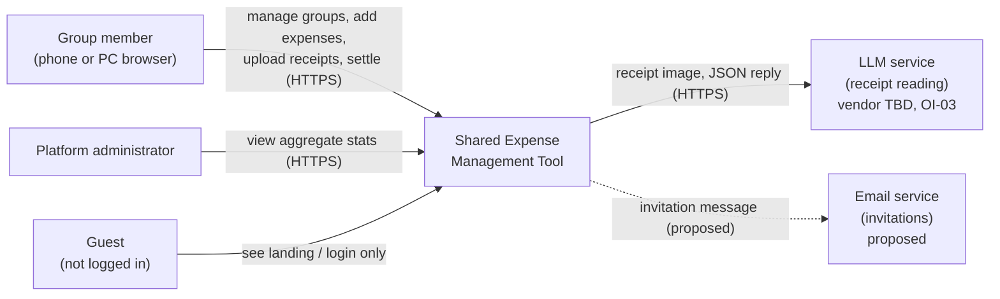
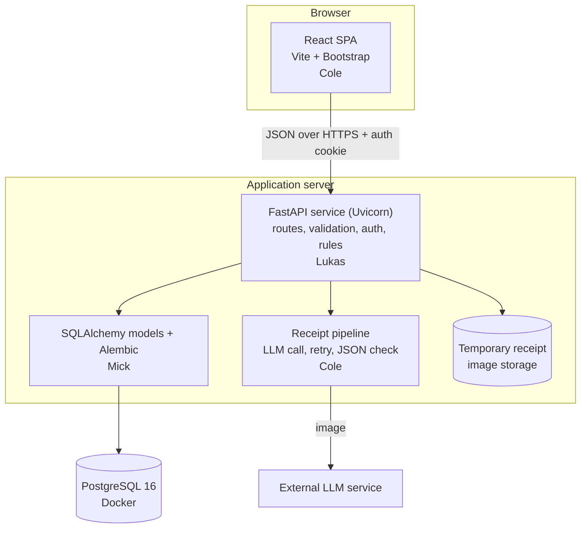
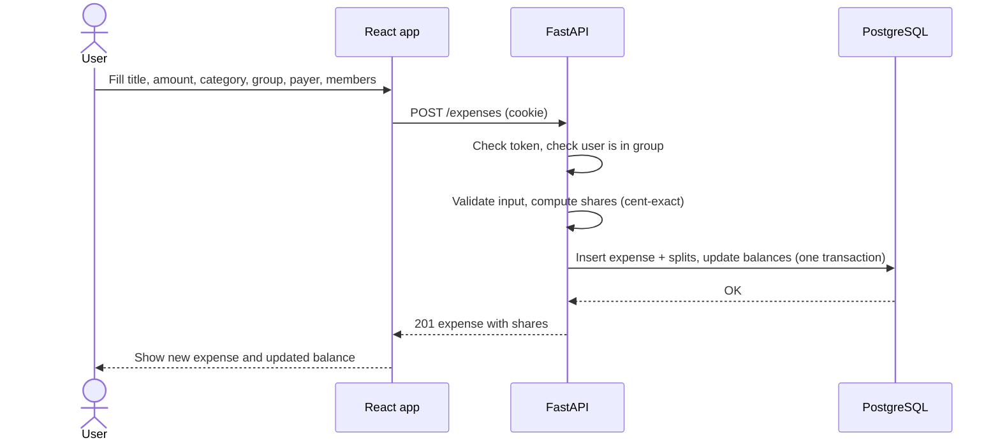
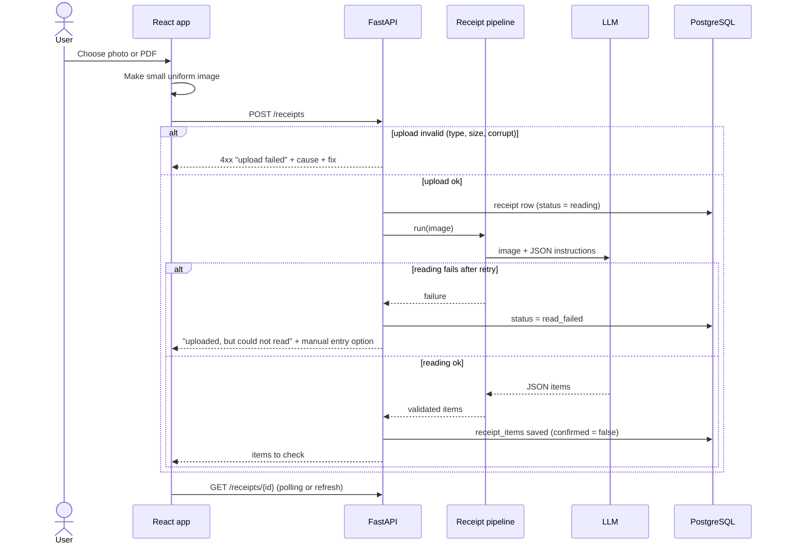
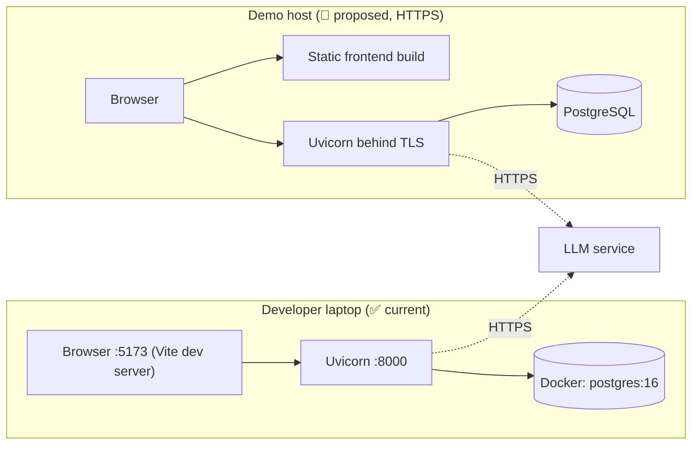
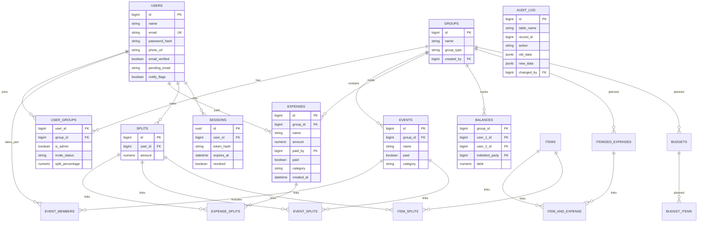

# System Architecture: Shared Expense Management Tool

*CS451R Agile Software Engineering Capstone*

| Document field | Team entry |
|---|---|
| Project title | Shared Expense Management Tool |
| Team name | LCMX Inc. |
| Team members | Colton "Cole" Hanson (frontend, LLM), Mick Leinbach (database), Lukas Viskovic (backend), Xander McKie (testing, documentation, Figma designs) |
| Student document owner | Xander McKie |
| Instructor | Prof. Jawad |
| Sponsor or client | Commerce Bank |
| Version and date | 1.0 Draft, October 29, 2026 |
| Approval status | Draft |

> Repository: <https://github.com/Colton-Hanson/LCMX-Inc.>
>
> **Status legend used throughout:** ✅ **Implemented** (in the repo and running) · 🟡 **In progress** (current sprint) · 🔵 **Proposed** (designed, not built yet).

## Revision history

| Version | Date | Author | Summary of change | Reviewer or approval |
|---|---|---|---|---|
| 0.1 | Oct 29, 2026 | Xander McKie | Initial draft from the Charter, Requirements, and current repo | Pending team review |
| 1.0 | Oct 29, 2026 | Xander McKie | First complete version for posting to the repo | Pending (Cole, Mick, Lukas) |

## Contents

1. [Architecture overview](#1-architecture-overview)
2. [Architecture drivers](#2-architecture-drivers)
3. [Stakeholders and concerns](#3-stakeholders-and-concerns)
4. [Architecture at a glance](#4-architecture-at-a-glance)
5. [System context view](#5-system-context-view)
6. [Logical view](#6-logical-view)
7. [Process and runtime view](#7-process-and-runtime-view)
8. [Development view](#8-development-view)
9. [Deployment view](#9-deployment-view)
10. [Use case view](#10-use-case-view)
11. [Data architecture](#11-data-architecture)
12. [Interfaces and APIs](#12-interfaces-and-apis)
13. [Security and privacy](#13-security-and-privacy)
14. [Quality attributes](#14-quality-attributes)
15. [Architecture decisions](#15-architecture-decisions)
16. [Traceability and risks](#16-traceability-and-risks)
17. [Architecture evolution](#17-architecture-evolution)
18. [Review and submission](#18-review-and-submission)

---

# 1 Architecture overview

## 1.1 Purpose and scope

This document describes the web application, REST API, PostgreSQL database, receipt-reading pipeline, automated tests, and demo deployment of the Shared Expense Management Tool. It is for the four team members, the instructor, and the sponsor. A teammate should be able to follow a request from the browser to the database and back, and find where data lives.

**Out of scope:** the internal design of third-party libraries, any real bank connection, and any real movement of money. The application only *records* that a debt was settled outside the app (Charter, Section: Out of scope; FR-SPL-17).

## 1.2 Architecture status

| Item | Status |
|---|---|
| Overall maturity | Iterations 0 to 4 are merged to `main` (last code merge Oct 27). Implemented: accounts, sessions, profile, groups, invitations, members, events, manual expenses with three split methods, and balances. Iteration 5 (Oct 26 to 30) is the prototype demo. Receipts begin in Iteration 6 (Nov 2 to 6). |
| Views complete | All 18 sections drafted from the repository as of Oct 29. Receipt pipeline, settlement, budgets, analysis, admin, and activity are 🔵 Proposed. |
| Known gaps | LLM vendor not final (OI-03). Demo hosting not final. Rate limiting not built. `GET /users` is unauthenticated. Password rule is enforced only in the browser. The event data model differs from the agreed design (ADR-05). No `GET /groups` route yet. |
| Next update | After Iteration 6 (receipt upload and AI reading) closes on Nov 6. |

## 1.3 System narrative

The Shared Expense Management Tool is a web app for people who share costs: roommates, partners, families, and groups on an outing. A user belongs to **groups**; a group can have **events** that involve only some of its members; any member can add an **expense**, which is divided into **splits**; the splits roll up into **balances** between each pair of people. A receipt photo can be uploaded and read by a language model so line items do not have to be typed in; the user always reviews and corrects what the model read before anything touches a balance (OBJ-3).

Technically it is a three-tier web app. A React single-page app (Vite, Bootstrap) in the browser talks JSON over HTTP (HTTPS on the demo host) to a FastAPI service. FastAPI uses SQLAlchemy to read and write PostgreSQL, and (from Iteration 6) calls an external LLM service to read receipt images. Think of it like a restaurant: the React app is the dining room, FastAPI is the kitchen that checks every order, PostgreSQL is the pantry that keeps the one true record, and the LLM is an outside specialist the kitchen calls only for one special dish.

---

# 2 Architecture drivers

## 2.1 Key use cases

| ID | Use case | Why it shapes the architecture |
|---|---|---|
| UC-01 | Create account / log in | Forces hashed passwords, token sessions, and an auth check on every protected route. |
| UC-04, UC-05, UC-06 | Create group, add/remove members, create event | Defines the group → event → expense containment and the member-subset rule. |
| UC-07, UC-09 | Add expense manually; autosplit | Needs a split engine that is exact to the cent and flags rounding leftovers. |
| UC-10 | Settle debt | Needs a ledger of settlements and pairwise balances; must never claim to move money. |
| UC-02, UC-08 | Receipt upload; review and assign | Introduces an external LLM, file storage, and a mandatory human review step. |
| UC-12, UC-15 | Monthly analysis; admin dashboard | Admin must see aggregates only; no individual user data (NFR-SEC-07). |

## 2.2 Quality attribute scenarios

| ID | Quality | Scenario | Response measure | Source |
|---|---|---|---|---|
| QA-01 | Security | An anonymous visitor requests any internal page or API route. | Redirected to login or given 401 with no hint the resource exists. | FR-ACC-12, NFR-SEC-04 |
| QA-02 | Security | A user requests another user's group, expense, or receipt by ID. | Denied; nothing returned (also applies to administrators). | NFR-SEC-07 |
| QA-03 | Data integrity | A $100.00 bill is split three ways. | Shares sum to exactly $100.00; the extra cent is assigned to one member and shown as such. | NFR-DAT-04, FR-SPL-08 |
| QA-04 | Reliability | The LLM misreads a receipt or is unreachable. | User sees "the picture uploaded, but reading failed" (distinct from an upload failure) and can enter items by hand. Nothing is saved to balances. | FR-EXP-17, OBJ-3 |
| QA-05 | Compatibility | A user opens the app on a phone and on a desktop. | All core flows work on both; no horizontal scroll at 390 px; menus reconfigure for mobile. | NFR-CMP-01 to 04 |
| QA-06 | Performance | Several users use the app at once during the demo. | Pages stay responsive; load check run before final submission. | NFR-PER-01 |
| QA-07 | Testability | A developer changes balance logic. | Automated tests run in one command and catch a regression before merge. | NFR-QUA-01 |

## 2.3 Constraints, assumptions, and risks

| Type | Statement | Impact |
|---|---|---|
| Constraint | PostgreSQL is the database. | Database is a Docker `postgres:16` container; no other store. |
| Constraint | Passwords are stored only as hashes. | Auth service hashes before any write. |
| Constraint | Exactly one CSS framework (Bootstrap). | No second UI library may be added. |
| Constraint | Must work on phone and PC browsers. | Responsive layout, touch-sized controls. |
| Constraint | Fixed academic calendar; final delivery Dec 7, 2026. | Scope is cut before dates move. |
| Constraint | Unit tests required. The Charter names unittest (PyUnit); the code uses **pytest** (backend) and **Vitest** (frontend). The exception still has to be recorded (OI-26, ADR-04). | Tests live in `backend/tests` and `frontend/tests`. |
| Assumption | An LLM with image-reading ability is available. | Receipt pipeline depends on it (R-1). |
| Assumption | The demo is served over HTTPS. | Deployment must provide TLS. |
| Assumption | Test data is synthetic; no real financial data is ever used. | Seed data and receipts are fake. |
| Risk | LLM misreads receipts (R-1). | Mitigated by mandatory human review. |
| Risk | Sponsor drifts toward real bank integration (R-7). | Out-of-scope list in the Charter is the answer. |

---

# 3 Stakeholders and concerns

| Stakeholder | Concern | Architecture response | Section |
|---|---|---|---|
| Sponsor (Commerce Bank) | Is it safe and does it stay inside the agreed scope? | No bank access, no money movement, hashed passwords, HTTPS | 13, 5 |
| Instructor (Prof. Jawad) | Are required documents, tests, and process present and consistent? | Traceability, test plan, DoD | 8, 16 |
| End users: group members | Fast, simple, trustworthy balances | Single balance source of truth, cent-exact math | 11, 14 |
| End users: group admins | Control over members and events | Group roles, remove-member checks | 6, 12 |
| Platform administrator | See usage health without seeing anyone's data | Aggregate-only admin endpoints | 13 |
| Developers (team) | Clear module boundaries and a runnable README | Layered backend, shared contract | 6, 8 |
| Testers | Repeatable tests and seed data | pytest, seed script, synthetic receipts | 8, 14 |

---

# 4 Architecture at a glance

## 4.1 Architecture style and rationale

**Style:** a three-tier web application with a separate single-page frontend and a layered REST API (routes → services → data access → database). One backend process, one database. No microservices.

**Why:** four students, one semester. A single deployable backend is the simplest thing that satisfies every requirement and is easy to run from the README. The layers keep Lukas's API code, Mick's data code, and Cole's frontend from stepping on each other. An analogy: a small restaurant does not need separate buildings for each cook; one kitchen with clear stations is enough.

## 4.2 Major elements

| Element | Responsibility | Technology | Owner | Status |
|---|---|---|---|---|
| Web client | Screens, forms, calls to API, responsive layout | React (Vite), Bootstrap 5, Vitest | Cole | ✅ 11 screens through Sprint 4; 🔵 receipt screens |
| API service | Routes, validation, auth, business rules | FastAPI, Uvicorn, Pydantic | Lukas | ✅ Auth, profile, groups, events, expenses, balances |
| Split and balance engine | Divide amounts exactly, update pairwise balances in one transaction | `app/services` (Python) | Lukas | ✅ |
| Data layer | Models, migrations | SQLAlchemy 2, Alembic (14 migrations) | Mick | ✅ Through Sprint 4; 🟡 Sprint 5 changes |
| Database | Persistent storage | PostgreSQL 16 (Docker) | Mick | ✅ |
| Receipt pipeline | Send image to LLM, return structured JSON, retry | Python module + LLM API (vendor OI-03) | Cole / Lukas | 🔵 Iteration 6 |
| Receipt image store | Hold uploaded images until confirmed | Server file storage (temporary) | Lukas | 🔵 |
| Test suite | Automated checks | pytest (108 passing at Sprint 4 handoff), Vitest | Xander / all | ✅ Grows each sprint |
| Admin dashboard | Aggregate counts only | Same API, admin role | Lukas / Cole | 🔵 Iteration 9 |

---

# 5 System context view

## 5.1 Context diagram

*Title: System context, Shared Expense Management Tool. Date: Oct 29, 2026.*

Legend: solid arrow = implemented or being built; dashed arrow = proposed. There is deliberately **no** arrow to a bank.

## 5.2 Context table

| External actor or system | Direction | Data exchanged | Trust level | Status |
|---|---|---|---|---|
| Group member | In/Out | Credentials, groups, expenses, receipt images, balances | Authenticated, can see only own groups | ✅ |
| Administrator | In/Out | Aggregate counts (users, groups, receipts) | Authenticated admin, no individual data | 🔵 |
| Guest | In | Login and registration requests only | Untrusted | ✅ |
| LLM service | Out/In | Receipt image out; structured item JSON back | Untrusted output: always validated, always reviewed by a human | 🟡 |
| Email service | Out | Invitation text | Low risk | 🔵 (stretch; invites are in-app first) |
| Bank / payment network | none | none | Not connected by design | Out of scope |

---

# 6 Logical view

## 6.1 Container diagram

*Title: Containers. Date: Oct 29, 2026.*

## 6.2 Components

Backend components inside the FastAPI container (`backend/app`):

| Component | Responsibility | Depends on | Status |
|---|---|---|---|
| `routes/auth`, `routes/profile` | Register, login, logout, `me`, change password, profile, email change | `security`, `sessions` | ✅ |
| `routes/groups`, `invitations`, `memberships` | Create group, invite, accept/decline, list and remove members with balance check | auth, balances | ✅ |
| `routes/events` | Event as a member subset inside one group | groups | ✅ (link to expenses 🔵) |
| `routes/expenses` | Create expense, list group expenses, balances | services | ✅ |
| `services/split_calculator` | Even, custom amount, percentage; cent-exact rounding with named remainder | none | ✅ |
| `services/expense_validation` | Membership, amount and split checks | groups | ✅ |
| `services/expense_persistence` | One transaction: expense, splits, balance update | models | ✅ |
| `api/dependencies` | `get_current_user` (cookie to session to user) | `sessions` | ✅ |
| `core/security` | Argon2 hashing, session token and hash, config from env vars | none | ✅ |
| `db/session` | Database session | none | ✅ |
| `routes/users`, `routes/health` | `GET /users` (⚠️ unauthenticated, see Section 13), `GET /health` | | ✅ |
| `receipts` | Upload endpoint, store image, run pipeline, save items, status | pipeline, expenses | 🔵 Iteration 6 |
| `settlements`, `budgets`, `analysis`, `admin`, `activity` | Later features | expenses, balances | 🔵 |

Frontend components (`frontend/src`): `pages/` (Home, Groups, Group, Group Settings, Create Group, Create Event, Add Expense, Balances, Settings, Login, Register), `components/` (shared UI such as header and bell menu), `api/` (the one place that calls the backend), `lib/` (validators, split and balance helpers, group and event caches). Cole's design system is the dark "Warm Teal" theme (primary `#3bb4b0`).

---

# 7 Process and runtime view

## 7.1 Key flows

**Flow A: add an expense with an even split (✅/🟡)**

**Flow B: receipt upload and reading (🟡 Iteration 6)**

After Iteration 7 the user reviews and assigns items; only then is `confirmed = true`, balances change, and the temporary picture is deleted (OI-17).

## 7.2 Concurrency, state, and failure behavior

| Topic | Design | Failure behavior |
|---|---|---|
| Concurrent writes | Each expense plus its splits and balance updates is **one database transaction**. | If any step fails, nothing is saved. |
| Receipt state | `reading` → `read` → `confirmed`, or `read_failed`. Items start `confirmed = false`. | Unconfirmed receipts never affect balances. |
| LLM call | One retry, then fail with a clear status. Output must parse as the expected JSON or it counts as a failure. | User can enter items manually. |
| Sessions | Token in an HTTP-only cookie with configurable expiry. | Expired token → 401 → frontend redirects to login. |
| Cancelled flows | Any cancelled create flow discards its draft (FR-GRP-06, FR-SPL-05, FR-EXP-25). | No partial rows. |
| Database down | API returns a generic 503; `/health` reports failure. | No stack traces to the user. |

---

# 8 Development view

## 8.1 Source organization

Repository: `Colton-Hanson/LCMX-Inc.`

| Path | Contents | Owner | Build / run | Test |
|---|---|---|---|---|
| `backend/app/api/routes` | One router file per area: `auth`, `profile`, `groups`, `invitations`, `memberships`, `events`, `expenses`, `users`, `health` | Lukas | `uvicorn app.main:app --reload` (port 8000) | `pytest` in `backend/` |
| `backend/app/schemas` | Pydantic request and response models | Lukas | n/a | covered by route tests |
| `backend/app/services` | `split_calculator`, `expense_validation`, `expense_persistence` (business rules) | Lukas | n/a | `test_split_calculator`, `test_expense_validation`, `test_expense_integration` |
| `backend/app/core`, `app/db`, `app/api/dependencies.py` | Password hashing, session helpers, DB session, `get_current_user` | Lukas | n/a | `test_auth` |
| `backend/models.py` | All SQLAlchemy models | Mick | n/a | n/a |
| `backend/alembic` | Migration chain (head `e13be2039d98`) | Mick | `alembic upgrade head` | applied before tests |
| `backend/seed.py` | Demo and test accounts and data | Mick | `python seed.py` | n/a |
| `backend/scripts/dev-postgres.sh` | Postgres without Docker (user-space) | Xander | see README | n/a |
| `backend/tests` | 12 test files: auth, profile, groups, invitations, memberships, events, expenses, balances, split calculator, validation, integration, health (108 passing at the Sprint 4 handoff) | Xander / Lukas | n/a | `pytest` |
| `frontend/src` | `pages/` (11 screens), `components/`, `api/` (all backend calls), `lib/` (validators, split and balance helpers, caches) | Cole | `npm install`, `npm run dev` (port 5173) | `npm test` (Vitest, `frontend/tests`, 24 files) |
| `docker-compose.yml` | PostgreSQL 16 container (database `shared_expense_dev`) | Mick | `docker compose up -d` | n/a |
| `db_starter_old/`, `shared_expense_db.zip` | Early database starter files, kept for reference | Mick | n/a | n/a |
| `projectcharter.md`, `projectrequirements.md`, `planningdoc.md` | Project documents | Xander | n/a | n/a |
| `backend/SPRINT4_BACKEND_HANDOFF.md`, `frontend/SPRINT4_FRONTEND_HANDOFF.md` | Sprint handoff notes | Lukas / Cole | n/a | n/a |

**Quick start (from the README):** `docker compose up -d`; in `backend/` create a virtual environment, `pip install -r requirements.txt`, copy `.env.example` to `.env` and fill in `DATABASE_URL` and `EMAIL_VERIFICATION_SECRET`, run `alembic upgrade head`, start uvicorn; check `http://localhost:8000/health` (returns `{"status":"ok"}`); in `frontend/` run `npm install` and `npm run dev`, then open `http://localhost:5173`.

## 8.2 Team structure and integration

The module split follows the team split: Cole owns the frontend (and later the receipt pipeline), Lukas the API, Mick the database, Xander the documentation and tests. This is Conway's Law working in our favor: the interfaces between modules (the API in Section 12 and the tables in Section 11) are the places the team must talk. Integration rules, all already in use:

- Work is tracked in JIRA; each ticket carries its requirement ID as a label.
- Feature branches (for example `lukas-it4`, `frontend-sprint4`, `sprint-5-db`) merge to `main` by reviewed pull request, and merge before the Friday close-out so the regression run covers them.
- A migration merges before the endpoint that uses it. Backend and frontend agree on request and response shapes at sprint kickoff, and the frontend builds against mocked responses until the endpoint lands.
- Definition of Done: merged, automated test passing, reviewed by someone other than the author, runnable from the README.

---

# 9 Deployment view

## 9.1 Deployment diagram

*Title: Deployment. Date: Oct 29, 2026.*

## 9.2 Environment inventory

| Environment | Purpose | Hosts | Data | Secrets | Status |
|---|---|---|---|---|---|
| Local (each developer) | Daily development | Docker Postgres, Uvicorn, Vite | Synthetic seed data | Local `.env`, never committed | ✅ |
| CI / test | Run pytest | Test database | Created per run | None real | 🔵 (tests run locally for now) |
| Demo | Final presentation and sponsor demo | To be chosen (TBD) | Synthetic only | Host-managed env vars | 🔵 |

---

# 10 Use case view

| Scenario | Path through the system | Views validated | Status |
|---|---|---|---|
| UC-01 Register and log in | Register/Login pages → `POST /auth/register`, `POST /auth/login` → `users` + `sessions` → cookie → `GET /auth/me` | Logical, runtime, security | ✅ |
| UC-13 Manage profile | Settings page → `PATCH /profile`, change password, email change with token | Logical, security | ✅ |
| UC-04 Create a group and invite | Create Group page → `POST /groups`, `POST /groups/{id}/invitations`, accept/decline on Home | Logical, data | ✅ |
| UC-05 Remove a member | Group Settings → `DELETE /groups/{id}/members/{uid}` with balance check and `?confirm=true` | Data, interfaces | ✅ |
| UC-06 Create an event | Create Event page → `POST /events` | Data | ✅ (event-expense link 🔵) |
| UC-07/09 Add expense and autosplit | Add Expense page → `POST /expenses` (Flow A, Section 7) | Runtime, data | ✅ |
| Balances | Balances page → `GET /balances` | Data, interfaces | ✅ |
| UC-02/08 Receipt to expense | Flow B in Section 7, then review and save | Runtime, interfaces, quality | 🔵 Iterations 6 and 7 |
| UC-10 Settle a debt | Settle Up screen → settlement endpoint (to be defined) | Data, interfaces | 🔵 Iteration 7 |
| UC-11/12 Budgets and analysis | Budget and analysis screens | Logical | 🔵 Iteration 8 |
| UC-15 Admin sees stats | Admin login → aggregate endpoint | Security | 🔵 Iteration 9 |

---

# 11 Data architecture

## 11.1 Entity relationship diagram

*Title: Core data model as implemented in `backend/models.py` (Alembic head `e13be2039d98`). Date: Oct 29, 2026. Receipt tables are 🔵 planned for Iteration 6; Budget, Item and related tables exist as stubs.*

**How an expense is stored today:** one `expenses` row (required `group_id`, payer, amount, optional category), one `splits` row per participant (amount owed), linked through `expense_splits`. The service then updates the pairwise `balances` rows for that group in the **same transaction**: the payer's own share is excluded from debt, and opposing debts are netted.

**Where the implementation and the design differ (to resolve):**

- The current `events` table holds its own `paid` and `category` columns and links to splits through `event_splits`, so an event is modelled as a payment split among a subset, not as a tag on an expense. The team direction agreed with the database owner on Oct 26 was: every expense has a required `group_id` and an **optional `event_id`**, and event balances are a filter on the single group balance. That change is **not in the schema yet** and needs a migration before event expenses are built (see ADR-05).
- Categories: a text column (`category`, 20 characters) on expenses and events, to be validated against a backend constant. There is no categories table in the models.
- `items`, `item_splits`, `itemized_expenses`, `item_and_expense`, `budgets`, `budget_items` exist as early placeholders with few columns. The receipts and receipt-items tables for Iteration 6 are not created yet.
- `audit_log` (JSONB old/new values) exists in the model; no route writes to it yet.

## 11.2 Data dictionary

| Entity | Purpose | Key fields | Validation | Retention |
|---|---|---|---|---|
| `users` | Accounts | email (unique, stored lower-case), name, password_hash, email_verified, pending_email, four notification flags | Email format; 409 on duplicate; password minimum 8 characters on the server | Until account deletion |
| `sessions` | Server-side login sessions | token_hash (SHA-256 of the cookie token), expires_at, revoked | Token must exist, be unexpired and not revoked | Until expiry or logout |
| `groups` | A sharing group | name (100), group_type (`roommate`, `partner`, `outing`, `family`), created_by | Type from fixed list | Until deleted |
| `user_groups` | Membership | is_admin, invite_status (pending, accepted), split_percentage (saved group default) | Only accepted members can see or add to a group | With group |
| `events` / `event_members` | Subset of a group | name (100), at least one member | `member_ids` must have at least one entry | With group |
| `expenses` | One shared payment | group_id, name (100), amount `NUMERIC(10,2)`, paid_by, category | Payer and participants must be accepted members; shares must sum exactly to the amount | With group |
| `splits` / `expense_splits` | Each person's share | user_id, amount | Even, custom amount, or percentage; rounding cents assigned to named members | With expense |
| `balances` | Running debt between two members, per group | user_1_id, user_2_id, indebted_party, debt | Updated only inside the expense transaction | With group |
| `audit_log` | Change history | table, record, action, old/new JSON | Written by services only (not yet wired) | Rolling |

**Migrations:** every schema change is an Alembic migration (14 so far, chain ends at `e13be2039d98`). Money columns use `NUMERIC`, never floats. Review changes to existing migration files before merging. `backend/seed.py` creates demo accounts using the shared `hash_password()` helper, so seeded logins work.

---

# 12 Interfaces and APIs

## 12.1 Interface catalog

All routes are JSON over HTTP(S). "Auth" means a valid session cookie (`access_token`) is required. The live, authoritative list is the FastAPI page at `/docs`.

| ID | Interface | Method and path | Auth | Status |
|---|---|---|---|---|
| API-01 | Health check | `GET /health` | No | ✅ |
| API-02 | Register | `POST /auth/register` (201; 409 duplicate email; 422 invalid) | No | ✅ |
| API-03 | Log in | `POST /auth/login` (sets cookie; generic 401 on failure) | No | ✅ |
| API-04 | Current user | `GET /auth/me` | Yes | ✅ |
| API-05 | Log out | `POST /auth/logout` (revokes session) | Yes | ✅ |
| API-06 | Change password | `POST /auth/change-password` | Yes | ✅ |
| API-07 | Profile | `GET /profile`, `PATCH /profile` | Yes | ✅ |
| API-08 | Email change with verification | `POST /profile/email-change`, `POST /profile/email-change/confirm` | Yes | ✅ |
| API-09 | Create group | `POST /groups` | Yes | ✅ |
| API-10 | Invitations | `POST /groups/{id}/invitations`, `GET /groups/invitations/pending`, `POST /groups/{id}/invitations/accept`, `POST /groups/{id}/invitations/decline` | Yes | ✅ |
| API-11 | Members | `GET /groups/{id}/members`, `DELETE /groups/{id}/members/{user_id}` (`?confirm=true` to remove with an outstanding balance) | Yes | ✅ |
| API-12 | Create event | `POST /events` (body: name, group_id, member_ids) | Yes | ✅ |
| API-13 | Create expense | `POST /expenses` (group_id, description, amount, paid_by, participant_ids, optional split_method and split_values) | Yes | ✅ |
| API-14 | List group expenses | `GET /groups/{id}/expenses` | Yes (accepted member) | ✅ |
| API-15 | Balances | `GET /balances` (returns group_balances, overall_balances, total_net) | Yes | ✅ |
| API-16 | List my groups | `GET /groups` | Yes | 🔵 not built; the frontend remembers groups in browser storage as a workaround |
| API-17 | Group detail, event list, edit/delete expense | to be defined | Yes | 🔵 |
| API-18 | Receipt upload and status | `POST /receipts`, `GET /receipts/{id}` | Yes | 🔵 Iteration 6 |
| API-19 | Receipt review, confirm, delete picture | to be defined | Yes | 🔵 Iteration 7 |
| API-20 | Settle debt | to be defined | Yes | 🔵 Iteration 7 |
| API-21 | Budgets, analysis | to be defined | Yes | 🔵 Iteration 8 |
| API-22 | Admin and activity | to be defined | Admin / Yes | 🔵 Iteration 9 |
| API-23 | LLM service | Outbound HTTPS call from the receipt pipeline | API key | 🔵 Iteration 6 |
| API-24 | `GET /users` | Lists every user's id and email | **None** | ⚠️ Defect, see Section 13 |

## 12.2 Contract details

| Topic | Rule |
|---|---|
| Authentication | Random session token in an HTTP-only cookie named `access_token`; the database stores only its SHA-256 hash in `sessions`. Protected routes use a shared `get_current_user` dependency. |
| Validation | Pydantic schemas on every request; bad input returns **422** (NFR-SEC-03). Expense input is additionally checked by `expense_validation` (membership, amounts, split values). |
| Money format | Request amounts are decimals; responses return amounts as **decimal strings** to avoid float errors. |
| Status codes | 200/201 success; 401 not logged in or bad login; 403/404 not allowed or not found; 409 duplicate; 422 invalid. |
| Authorization | Group routes require accepted membership; balance and expense routes are scoped to the signed-in user. |
| Rate limiting | Not implemented yet (NFR-SEC-05). 🔵 |
| Versioning | None; routes are unversioned during the semester. Breaking changes are announced to the team first. |
| File upload | Planned: PDF, JPEG, or camera image with type and size validation (FR-EXP-10, 16). |

---

# 13 Security and privacy

## 13.1 Threats and trust boundaries

Trust boundaries: browser ↔ API, API ↔ database, API ↔ LLM service (planned). Everything crossing a boundary is validated.

| Threat | Asset | Mitigation | Status |
|---|---|---|---|
| Stolen or guessed password | Accounts | Argon2 hashing; generic login errors; minimum 8 characters | ✅ hashing and generic errors |
| Weak passwords | Accounts | The frontend checks 8 characters, one capital letter and one symbol, but the **server enforces only the 8-character minimum** | ⚠️ gap (add server-side rule and a test) |
| Brute-force login or upload spam | Accounts, server | Rate limiting on auth and sensitive routes (NFR-SEC-05) | 🔵 not built |
| Reading someone else's data | Groups, expenses, balances | Per-request membership check and signed-in user scoping | ✅ for expenses, balances, members; keep testing each new route |
| User list exposure | Email addresses of all users | `GET /users` has no authentication and returns every id and email | ⚠️ **defect: remove the route or restrict it before the final demo** |
| SQL injection | Database | SQLAlchemy parameterised queries; schema validation | ✅ |
| Session theft | Sessions | Random token, only its hash stored; HTTP-only cookie; revocation on logout; expiry (`SESSION_EXPIRE_HOURS`, default 168); `COOKIE_SECURE` flag for HTTPS | ✅ (set `COOKIE_SECURE=true` on the demo host) |
| Malicious upload file | Server | Type and size checks; store outside web root; never execute | 🔵 |
| LLM returns bad or hostile text | Balances | Strict JSON parse and validation; human review before saving | 🔵 |
| Secrets committed | Keys | `.env` ignored by git; `.env.example` holds placeholders only | ✅ |
| Admin snooping on users | Privacy | Admin endpoints return aggregates only (NFR-SEC-07) | 🔵 |
| Interception | All traffic | HTTPS on the demo host | 🔵 |

## 13.2 Security decisions

| Topic | Decision |
|---|---|
| Authentication | Register, login, me, logout, change password, email change with a time-limited verification token (`PyJWT`, 30-minute default). |
| Password handling | Hashed with Argon2 (via `pwdlib`); plaintext is never stored or logged (FR-ACC-05). |
| Sessions | Server-side `sessions` table keyed by a hashed random token; cookie `access_token`; logout revokes. |
| Authorization | Roles: member, group admin (`user_groups.is_admin`), and a planned platform admin who sees aggregates only. |
| Input and output protection | Server-side validation of all input; React escapes output by default; strict JSON from the LLM (planned). |
| Secrets | `DATABASE_URL`, `EMAIL_VERIFICATION_SECRET`, and (later) the LLM key live in environment variables. Other settings: `SESSION_EXPIRE_HOURS`, `COOKIE_SECURE`, `EMAIL_VERIFICATION_EXPIRE_MINUTES`. |
| Logging | Never log passwords, tokens, or receipt contents. |
| Financial data | All data is synthetic. No bank credentials or account numbers are collected. Receipt images will be temporary and deleted after confirmation. |

---

# 14 Quality attributes

| Attribute | Approach | How we check |
|---|---|---|
| Performance | Indexed foreign keys; one transaction per expense; images resized in the browser before upload | Load check before final submission (NFR-PER-01) |
| Reliability | Transactions; distinct upload vs reading failures; cancelled flows discard drafts | Failure-case tests |
| Accessibility | Semantic HTML, labeled form controls, readable contrast, keyboard use | ADA checklist audit in the hardening sprint (NFR-A11Y-04) |
| Responsive design | Bootstrap grid, touch-sized buttons, mobile menu | Manual check at 390 px and desktop widths |
| Maintainability | Layered backend, one API client file in the frontend, migrations for every schema change | Code review on every merge |
| Testability | pytest for the API; synthetic seed data; 15-receipt test set for the pipeline | `pytest` passes before merge (Definition of Done) |
| Observability | `/health`, structured error logs, receipt status field | Checked during the demo run-through |
| Money accuracy | `NUMERIC` columns, remainder cents visibly assigned | Unit tests on split rounding |

---

# 15 Architecture decisions

## 15.1 Decision index

| ID | Decision | Status | Date |
|---|---|---|---|
| ADR-01 | FastAPI (Python) for the backend | Accepted, implemented | Sep 2026 |
| ADR-02 | PostgreSQL 16 in Docker, SQLAlchemy 2 + Alembic | Accepted, implemented | Sep 2026 |
| ADR-03 | React with Vite and Bootstrap as the single CSS framework | Accepted, implemented | Sep 2026 |
| ADR-04 | pytest (backend) and Vitest (frontend) for tests; the Charter names unittest (OI-26) | Implemented; exception needs to be recorded | Oct 2026 |
| ADR-05 | Expense belongs to a group; event is an optional tag and filter, not a second ledger | Accepted, **not yet in schema** | Oct 26, 2026 |
| ADR-06 | Categories are a validated text column, not a table | Accepted, partly implemented | Oct 26, 2026 |
| ADR-07 | Receipt picture is temporary: kept until confirmed, then deleted | Accepted, 🔵 | Oct 26, 2026 |
| ADR-08 | Frontend creates small uniform receipt images | Accepted, 🔵 | Oct 26, 2026 |
| ADR-09 | Server-side sessions: random token in an HTTP-only cookie, only its hash stored | Accepted, implemented | Oct 2026 |
| ADR-10 | Argon2 password hashing via `pwdlib` | Accepted, implemented | Oct 2026 |
| ADR-11 | Browser-stored group list until `GET /groups` exists (temporary workaround) | Accepted, to be removed | Oct 2026 |
| ADR-12 | LLM vendor selection | Proposed (OI-03, Cole) | Pending |

## 15.2 Decision records

**ADR-05: Expense belongs to a group, event is optional**

- **Context:** The current schema models an event as its own payment (`events.paid`, `events.category`, `event_splits`). The team discussed that an event is really a subset of the group and that an expense should not belong to an event in a second ledger.
- **Decision:** Every expense keeps its required `group_id` and gets an optional `event_id`. Event balances are a filter on the single group balance.
- **Alternatives:** A separate balance ledger per event (rejected: two sources of truth).
- **Consequences:** Needs a migration and a change to `expense_persistence` before event expenses are built. The unused event columns and `event_splits` table should be removed or repurposed in the same migration.

**ADR-09: Server-side sessions**

- **Context:** NFR-SEC-04 requires token sessions and per-route authorization; logout must really end a session.
- **Decision:** On login the server creates a random token, stores its SHA-256 hash with an expiry in `sessions`, and sends the raw token in an HTTP-only cookie (`access_token`). `get_current_user` looks the hash up on every request.
- **Alternatives:** Self-contained JWT (rejected: cannot be revoked at logout without extra state). PyJWT is still used for the short email-change verification token.
- **Consequences:** One extra database lookup per request; sessions can be revoked; the cookie `Secure` flag is controlled by `COOKIE_SECURE`.

**ADR-04: pytest and Vitest**

- **Context:** The Charter and NFR-QUA-01 name unittest (PyUnit). The backend suite is written with pytest (`pytest.ini`) and the frontend with Vitest.
- **Decision:** Keep pytest and Vitest; they are the working test tools in the repo.
- **Consequences:** The exception to NFR-QUA-01 must be written into the README, the Requirements OI-26 resolution, and the Project Plan (the plan currently still lists unittest).

*(Remaining ADRs use the same Context, Decision, Alternatives, Consequences format and will be written out as they are revisited.)*

---

# 16 Traceability and risks

## 16.1 Traceability

| Requirement | Architecture element | View | Verification |
|---|---|---|---|
| FR-ACC-01 to 17 | `auth`, `profile` routes, `users`, `sessions` | Logical, Security | `test_auth`, `test_profile`, frontend auth tests (✅) |
| FR-GRP-01 to 16 | `groups`, `invitations`, `memberships`, `events` routes | Logical, Data | `test_groups`, `test_invitations`, `test_memberships`, `test_events` (✅) |
| FR-EXP-01 to 05, FR-SPL-06 to 08, 10 | `expenses` route, `split_calculator`, `expense_validation`, `expense_persistence` | Runtime Flow A | `test_split_calculator`, `test_expenses`, `test_expense_integration` (✅) |
| FR-SPL-11, 12 | `balances` table, `GET /balances`, Balances page | Data | `test_balance_routes` (✅) |
| FR-EXP-10 to 17 | `receipts`, receipt pipeline | Runtime Flow B | 15-receipt test set, API tests (🔵 Iteration 6) |
| FR-EXP-20 to 33 | Review screen, confirm, picture deletion | Runtime, Data | Iteration 7 |
| FR-SPL-13 to 17 | Settlement (to be designed) | Data | Iteration 7 |
| FR-BUD, FR-ANL | Budgets and analysis | Logical | Iteration 8 |
| FR-ADM, FR-SOC | Admin and activity | Security | Iteration 9 |
| NFR-SEC-01 to 08 | Section 13 | Security | Security audit checklist (Iteration 10) |
| NFR-CMP, NFR-A11Y | Frontend | Quality | Manual checks, ADA checklist (Iteration 10) |
| NFR-PER | API and DB | Quality | Load check (Iteration 10) |

## 16.2 Architecture risks

| ID | Risk | Likelihood | Impact | Mitigation | Owner |
|---|---|---|---|---|---|
| AR-01 | LLM output is wrong or inconsistent | High | Medium | Strict JSON check, retry, mandatory human review, 15-receipt test set | Cole |
| AR-02 | Authorization check missed on a new route (`GET /users` already is) | Medium | High | Shared `get_current_user` dependency; a test that every route except health, register and login rejects anonymous calls | Lukas |
| AR-03 | Rounding errors in splits | Low | High | `NUMERIC`, remainder-cent rule, split calculator tests | Lukas |
| AR-04 | Schema changes break other modules; event model change (ADR-05) | Medium | Medium | Alembic migrations merged before endpoints; announce changes | Mick |
| AR-05 | No final hosting decision | Medium | Medium | Decide by the end of Iteration 9; local demo is the fallback | Team |
| AR-06 | Password rule enforced only in the browser | Medium | Low | Add the server-side rule and a test | Lukas |
| AR-07 | Group list kept in browser storage only | Medium | Low | Add `GET /groups` and remove the workaround | Lukas / Cole |

---

# 17 Architecture evolution

The team reviews this document at the end of every sprint and whenever a major component, interface, data model, deployment approach, security boundary, or important decision changes. Xander updates it; the owner of the changed part (Cole, Lukas, or Mick) confirms the update.

**Diagram rules:**

- Every diagram has a title, a date, a legend, and labeled arrows.
- Proposed parts are drawn dashed or marked 🔵; built parts are marked ✅.
- Diagrams are written in Mermaid so they render on GitHub and change with normal pull requests.
- No real financial data appears in any diagram or example.

---

# 18 Review and submission

## 18.1 Review table

| Reviewer | Role | Date | Decision | Comments |
|---|---|---|---|---|
| Commerce Bank | Sponsor | | | |
| Prof. Jawad | Instructor | | | |
| Team member (TBD) | Architecture lead | | | |

## 18.2 Completeness checklist

- [x] All 18 sections present; template prompts removed
- [x] Real use cases, requirement IDs, constraints, and decisions used
- [x] Diagrams have titles, dates, legends, and labeled arrows
- [x] No real financial data
- [x] Implemented, in-progress, and proposed elements are marked
- [ ] Team name confirmed
- [ ] LLM vendor (OI-03) and demo hosting decided and added
- [ ] Team lead review of Sections 6, 11, and 12 by Lukas, Mick, and Cole
